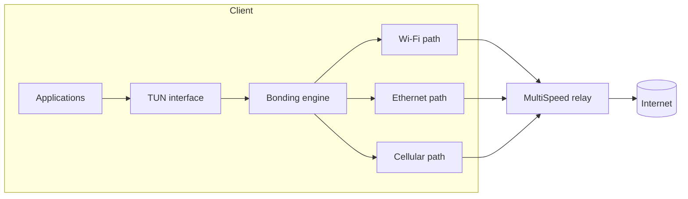

# MultiSpeed

**Open-source link bonding for Windows and Linux. Android is next.**

MultiSpeed combines Wi-Fi, Ethernet, cellular, Starlink, and other internet
connections into one encrypted tunnel: faster aggregate throughput when the
network allows it, smoother failover when a link drops, and no subscription.

MultiSpeed is an independent, clean-room implementation inspired by products
such as Speedify. It is **not affiliated with, endorsed by, or derived from
Speedify**. The goal is a transparent, self-hostable alternative that anyone
can audit, run, and improve.

> [!WARNING]
> **Pre-alpha software. Do not rely on MultiSpeed yet.**
> The Windows and Linux clients and the Linux relay work over loopback and
> WSL2, but real multi-ISP deployments have not been validated. The protocol
> and configuration formats are still changing, the cryptography is
> unaudited, and there is no installer, public relay network, or kill switch.
> IPv6 is not carried inside the tunnel. Do not use
> MultiSpeed to protect sensitive traffic or as a replacement for a mature VPN
> today.

## Status

| Component | State |
| --- | --- |
| Protocol, crypto, bonding core | Implemented and unit-tested; not audited |
| Linux relay | TUN forwarding, NAT, allowlist, systemd unit; tested over loopback in WSL2 only |
| Windows client CLI | Wintun TUN, per-path socket binding, automatic routes/DNS, rollback |
| Linux client CLI | TUN, `SO_BINDTODEVICE`, `iproute2` routes, `resolvectl`/`resolv.conf` DNS |
| Desktop app | Wails v2 app with profile picker, connect/disconnect, live path stats, logs |
| Android client | Not started |
| Real multi-ISP testing | Not done; no public VPS testing yet |

**Working now**

- [x] Noise IK handshake and ChaCha20-Poly1305 encrypted UDP transport
- [x] Multiple simultaneous paths with replay protection
- [x] Smooth weighted round-robin scheduling with loss penalties
- [x] Bounded reordering and duplicate suppression
- [x] Automatic session reconnect with exponential backoff after relay restarts or total path loss
- [x] Per-path RTT, jitter, loss, and throughput telemetry
- [x] Windows and Linux clients with automatic route and DNS setup
- [x] IPv4 default-route capture, relay bypass route, and best-effort IPv6 leak
      blocking
- [x] Route, DNS, and interface rollback on disconnect or failed setup
- [x] Linux relay with TUN forwarding, source NAT, and client isolation
- [x] Per-IP handshake rate limiting, bounded session table, and pending-session timeouts
- [x] Relay `init`, `check`, `keygen`, and client `check`, `discover`, `keygen`
- [x] Wails desktop control panel
- [x] Simulated loss, jitter, latency, and path-outage integration tests
- [x] Unit tests, loopback end-to-end tests, parser fuzzing, Linux race tests

**Not implemented yet**

- [ ] Android `VpnService` client
- [ ] Kill switch and crash-safe route recovery
- [ ] Redundancy mode for calls and gaming
- [ ] Split tunneling
- [ ] Tray icon, start on login, and an unprivileged GUI with a privileged helper
- [ ] Installers and signed release packages
- [ ] IPv6 inside the tunnel
- [ ] Throughput and CPU benchmarks
- [ ] Independent security audit

## Why another bonding tool?

- **Self-hosted first.** Run the relay on your own VPS. You own the keys, logs,
  and bandwidth. No account, subscription, or traffic quota.
- **Packet-level bonding.** Bond arbitrary IP traffic, not just selected
  applications or TCP flows.
- **Adaptive multipath transport.** Latency-, loss-, and capacity-aware path
  selection with a bounded reorder buffer.
- **Open source end to end.** Client, relay, protocol, and tests are in this
  repository under GPL-3.0.
- **A real desktop app.** A Wails-based control panel for Windows, with a Linux
  build path from the same code.

## How it works



The client captures IP packets from a TUN interface, encrypts each packet, and
stripes the resulting datagrams across every available path. The relay decrypts,
reorders, and forwards packets through its normal internet connection. Return
traffic follows the reverse path. A path can disappear at any time without
killing the session.

See [docs/architecture.md](docs/architecture.md) and
[docs/protocol.md](docs/protocol.md) for the design.

## Getting started

You need a Linux host for the relay and a Windows or Linux machine for the
client. During development, a WSL2 Ubuntu instance works as both.

### 1. Build from source

```powershell
# From the repository root
go build -o dist/multispeed.exe ./cmd/multispeed
go build -o dist/multispeed-relay.exe ./cmd/multispeed-relay

# Cross-compile the relay for a Linux VPS
$env:GOOS = "linux"; $env:GOARCH = "amd64"
go build -trimpath -o dist/multispeed-relay-linux-amd64 ./cmd/multispeed-relay
```

On Linux, build with `go build -o multispeed ./cmd/multispeed` and likewise for
the relay.

### 2. Create the relay and client configuration

On the relay host:

```bash
./multispeed-relay init -dir ./multispeed-config -server relay.example.com:7443
```

This writes `relay.json` (relay private key plus the client allowlist) and
`client.json` (client private key plus the relay public key). Edit the server
address if needed, then copy `client.json` to the client over a secure channel.
Both files are secrets; keep them mode `0600` on Linux and never commit them.

Validate a configuration without starting the service:

```bash
./multispeed-relay check -config ./multispeed-config/relay.json
```

Add more clients with `multispeed-relay keygen -name laptop` and append their
public keys and tunnel addresses to the relay allowlist.

### 3. Prepare the relay network

The setup script creates the TUN interface, enables IPv4 forwarding, configures
nftables source NAT, and isolates clients from each other and from the relay's
local network:

```bash
sudo ./scripts/relay-setup.sh --wan-if eth0
sudo ./multispeed-relay run -config ./multispeed-config/relay.json
```

For a persistent deployment, see [docs/deployment.md](docs/deployment.md) and
the systemd unit in [deploy/multispeed-relay.service](deploy/multispeed-relay.service).
Remember to allow UDP 7443 through the provider's firewall or security group.

### 4. Run the client

On Windows, place `wintun.dll` next to `multispeed.exe` (download it from
<https://www.wintun.net/>; Wintun is GPL-2.0 and is not bundled), then run from
an elevated PowerShell:

```powershell
.\dist\multispeed.exe run -config client.json
```

On Linux:

```bash
sudo ./multispeed run -config client.json
```

The client creates the TUN device, moves IPv4 default traffic into the tunnel,
pins the relay address to the physical link, and restores routes and DNS when
it exits. Useful flags:

- `-dry-run` establishes the relay session without creating a TUN device.
- `-no-routes` leaves routing alone; `-no-dns` leaves DNS alone.
- `-stats 5s` changes the status interval; `-debug` enables debug logging.
- `multispeed discover` lists interfaces that can be used as paths.

IPv6 is not tunneled. The client installs IPv6 blackhole routes so traffic
cannot leak around the tunnel, and DNS is sent to the relay-assigned resolver
when one is configured.

### 5. Build the desktop app

```powershell
cd gui
wails build
```

The executable is written to `gui/build/bin/MultiSpeed.exe`. Copy `wintun.dll`
beside it. The app requests administrator rights because it creates a TUN
device and changes system routes. See [gui/README.md](gui/README.md) for
requirements and development mode.

### Testing

```powershell
go test ./...
```

Linux-specific route tests and the race detector run in WSL:

```powershell
wsl -d Ubuntu -- bash scripts/wsl-test.sh -race
```

WSL needs more than its default 1 GB of memory for the race suite; raise
`memory=` in `%USERPROFILE%\.wslconfig` and run `wsl --shutdown` if the VM is
OOM-killed.

## Repository layout

```text
cmd/                  Client and relay binaries
internal/protocol/    Wire format and control messages
internal/crypto/      Handshake, traffic encryption, replay protection
internal/bond/        Path state, scheduler, reordering
internal/client/      Client session and packet pumps
internal/relay/       Relay sessions, allowlist, forwarding
internal/transport/   UDP paths, interface binding, discovery
internal/tun/         Wintun/Linux TUN adapters and test null device
internal/route/       Windows/Linux route, DNS, and rollback
internal/netsim/      UDP impairment proxy for integration tests
internal/e2e/         Loopback relay/client integration tests
gui/                  Wails desktop app (separate Go module)
deploy/               systemd unit for the relay
docs/                 Architecture, protocol, security, deployment, roadmap
scripts/              Relay network setup and WSL test helpers
```

## Operational reality

- **Relay bandwidth is the main cost.** MultiSpeed does not provide relays.
  A VPS with a generous traffic allowance and a good uplink is required, and
  the relay's uplink caps the aggregate tunnel speed.
- **Bonding is not magic.** Many flows can use several paths at once, and a
  dropped link no longer kills the session. A single TCP flow still follows
  one path most of the time, so a single-threaded download will not always be
  several times faster.
- **Outages are survivable, not invisible.** If every path fails or the relay
  restarts, the client keeps its TUN device and routes, then reconnects with
  exponential backoff. Active flows stall until the relay is reachable again.
- **Reordering has a cost.** The default 100 ms playout window trades latency
  for tolerance of slow paths. Interactive traffic may prefer a smaller window
  or, eventually, redundancy mode.
- **IPv6 is blocked, not tunneled.** If IPv6 matters to you, disable it on the
  physical adapters or wait for the IPv6 milestone.

## Security

The design uses established primitives:

- X25519 and Noise IK for mutual authentication and forward secrecy
- HKDF-SHA256 for traffic key derivation
- ChaCha20-Poly1305 for authenticated encryption
- A 2048-packet sliding replay window per direction and frame type

The code is **not audited**. See [docs/security.md](docs/security.md) for the
threat model, limitations, and disclosure policy. Please report vulnerabilities
privately as described in [SECURITY.md](SECURITY.md).

## License

Copyright (C) 2026 MultiSpeed contributors.

Licensed under the [GNU General Public License v3.0](LICENSE). You may run,
study, share, and modify MultiSpeed. If you distribute a modified version, you
must publish its source under the same license.
